# Hi, I'm Pri

Full-stack engineer. I build streaming apps for Android, Android TV, Fire TV and Roku, plus the Node.js backends behind them.

## What I work on

- Android, Android TV and Fire TV apps in Kotlin and Jetpack Compose
- Roku channels in BrightScript
- Node.js backend services and APIs that power those apps
- Shared libraries used across the apps
- CI, releases, and developer workflow automation with Bitrise, GitHub, and Jira

## Stack

**Mobile & TV** · Android, Android TV, Fire TV, Jetpack Compose, Compose for TV, Roku SceneGraph  
**Video & ads** · Media3, Google IMA, Google Cast, Google Ad Manager, Amazon APS, Roku Ads Framework, PubMatic OpenWrap, header bidding, native and outstream video ad SDKs  
**Analytics & engagement** · Firebase (Analytics, Crashlytics, FCM), Comscore, Conviva, Braze, Kochava, Datadog, audience data, push and consent management SDKs  
**Android** · Coroutines, Navigation, Room, Retrofit, OkHttp, Moshi, Gson, Coil, Glide, Fresco, WorkManager, Koin, Timber, Google Maps, Login with Amazon  
**Backend** · Node.js, NestJS, TypeScript, Fastify, AWS SDK, MongoDB, Redis, GraphQL, OpenTelemetry, Winston, Docker  
**Testing** · JUnit 5, MockK, Mockito, Kotest, Espresso, Barista, Robolectric, Jest, Mocha, Rooibos, Charles Proxy, Proxyman  
**Tooling** · Git, GitHub Actions, Bitrise, CircleCI, SonarQube, BrighterScript, roku-deploy, Appium, Jira, Linux, Bash, MCP, LLM tooling

## AI

> I don't treat AI as a substitute. I treat it as leverage.

- Designing custom agents and agent skills for real workflows
- Building LLM-powered automations with a human still in the loop
- AI-assisted code review, testing, and documentation
- Tool integrations and MCP servers that connect models to day-to-day engineering work

## Reach me

[pri.apocalypse@gmail.com](mailto:pri.apocalypse@gmail.com)

 

  <picture>
    <source media="(prefers-color-scheme: dark)" srcset="./profile/stats-dark.svg" />
    
  </picture>
  &nbsp;
  <picture>
    <source media="(prefers-color-scheme: dark)" srcset="./profile/top-langs-dark.svg" />
    
  </picture>

